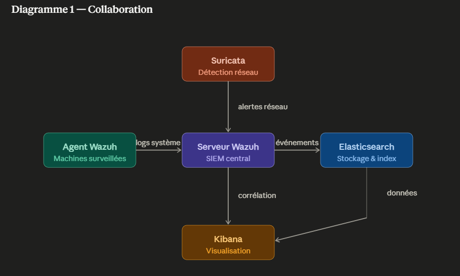

# SOC académique

## Présentation

Projet académique de mise en place et d’étude d’un environnement de supervision de sécurité. Le travail porte sur la collecte et l’analyse de journaux de sécurité, notamment des journaux Windows, la détection d’alertes réseau et leur visualisation dans Kibana.

## Technologies

Wazuh, Elasticsearch, Kibana, Elastic Agent, Fleet, Suricata, Ubuntu Server, Kali Linux, VMware et Git.

## Éléments disponibles

Le schéma d’architecture présent dans  illustre les liens entre Suricata, les agents Wazuh, le serveur Wazuh, Elasticsearch et Kibana. Les autres captures repérées comportent des détails de réseau ou de compte et ne sont pas incluses.

## Cadre

Projet académique et environnement de laboratoire. Cette description résume les activités indiquées dans les informations de portfolio ; elle ne revendique pas d’expérience professionnelle.
